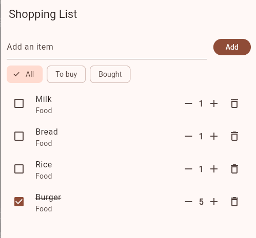
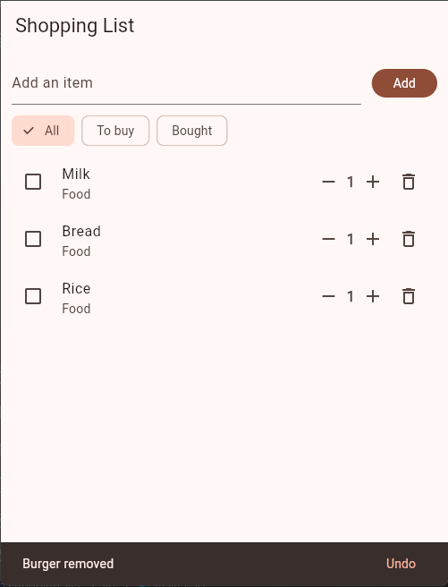
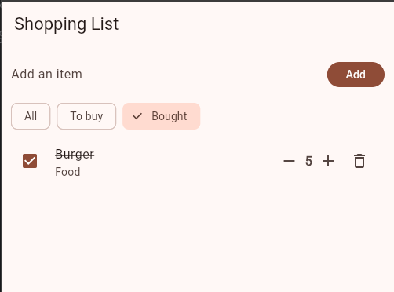
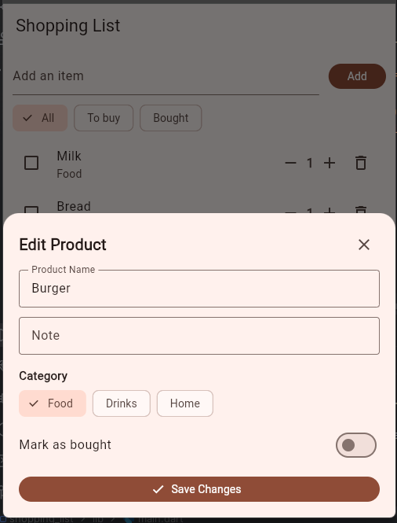

# Shopping List+

A Flutter shopping list application enhanced with item quantities, duplicate handling, deletion undo, filter views, and item detail editing.

---

## Features

### 1. Nothing to Show (Empty List Message)
- When the shopping list contains no items, the app displays a friendly `"Your list is empty"` message centered on the screen instead of a blank space.
- Adding an item immediately brings back the list view.

### 2. How Many? (Quantity Management)
- Every item has a quantity (starting at 1).
- Incremental controls (`−` and `+`) are positioned next to the item row before the delete icon.
- Tapping `+` increments the quantity.
- Tapping `−` decrements the quantity, strictly constrained so it never falls below 1. Items can only be completely removed using the trash icon.
- The trailing row uses `MainAxisSize.min` to prevent layout overflow.

### 3. No Duplicates, Just More (Duplicate Handling)
- Adding an item that already exists—regardless of letter casing or extra surrounding spaces (e.g., `milk`, ` MILK `)—does not create duplicate rows.
- Instead, the existing item's quantity increments by 1, and a notification appears: `"<Item> is already on the list: now ×<qty>"`.
- Newly typed items that do not exist are added normally with a default quantity of 1.

### 4. Oops: Undo (Undo Delete)
- Deleting an item triggers a `SnackBar` displaying `"<Item> removed"` with an **Undo** action button.
- Previous SnackBars are immediately cleared with `hideCurrentSnackBar()` to avoid queue buildup.
- Tapping **Undo** restores the removed item back into its exact original position, preserving its quantity, category, note, and bought status.

### 5. Show Me What's Left (Filter Chips & Reordering)
- Three filter choice chips appear below the input field: **All**, **To buy**, and **Bought**.
- **All**: Displays all items, with bought (crossed-out) items automatically positioned at the bottom of the list.
- **To buy**: Displays only items that have not yet been marked as bought.
- **Bought**: Displays only bought items.
- If a filter view has no matching items (while the list overall is not empty), the app displays `"Nothing here"`.
- All operations (marking as bought/unbought, quantity changes, deleting, and undoing) work consistently across all filter views.

### 6. Item Details & Offcanvas Quick Edit Form
- **Tap to Edit (Offcanvas Form)**: Tapping on any item opens a sleek modal bottom sheet (offcanvas form) allowing quick editing of the item's name, note, category chips (**Food**, **Drinks**, **Home**), and a toggle to mark as bought/unbought.
- **Checkbox for Status**: Each item has a leading checkbox that toggles its bought status directly from the list without opening the edit sheet.
- **Full Screen Details**: Long-pressing an item navigates to the full **Item details** screen with a top AppBar and back arrow.
- Tapping **Save** / **Save Changes** validates that the name is not empty and saves the changes.
- The main list displays the category and note underneath each item name (e.g., `Drinks · the 1 litre bottle`).

---

## Think

### 1. In part 5, why does deleting by `index` remove the wrong item when a filter is on? How did you fix it?
When a filter is active (such as "Bought" or "To buy"), the `ListView.builder` renders from a derived, filtered list (`shown`) rather than the master list (`items`). As a result, the `index` provided to the `itemBuilder` corresponds to the position inside `shown`, which does not match the item's actual position in `items`. For instance, the first item in the "Bought" view is at index 0 of `shown`, but it might be at index 5 in `items`. Calling `items.removeAt(index)` would delete whatever item happens to be at index 0 of `items` (an unbought item).

**How it was fixed:**
Instead of removing by index, we locate the item's true position in the source list using `final removedIndex = items.indexOf(item);` and remove the item instance directly using `items.remove(item);`. We also retain `removedIndex` so that tapping **Undo** re-inserts the item at its exact original position (`items.insert(removedIndex, removedItem)`).

---

### 2. Why did you have to remove `final` from `name`? Why is `final` still a good choice for most fields?
In Dart, a variable declared as `final` can only be assigned once during construction and cannot be reassigned or mutated later. In Part 6, the Item Details screen allows users to rename items (e.g., renaming "Rice" to "Brown rice"). If `name` remained `final`, attempting to update `item.name = name;` would result in a compilation error: `'name' can't be used as a setter because it's final`.

`final` is still a best practice for most fields because immutability prevents unintended state side-effects, makes data flow predictable, prevents bugs caused by accidental reassignment, and allows Dart and Flutter to optimize memory and widget rebuilds safely.

---

### 3. Why did you need a hot restart after adding `quantity` to `Item`, when a save was enough for everything else?
Flutter's Hot Reload injects updated code and widget build methods into the currently running Dart VM while preserving the existing in-memory state. When we add a new field like `int quantity;` to the `Item` class, any `Item` instances already residing in memory were created under the prior class schema without that property initialized. A simple hot reload cannot alter the memory layout of already-instantiated objects or re-run the initial state constructors. A **Hot Restart** completely restarts the Dart VM, executes `main()` from scratch, and recreates the list with new `Item` objects that include the `quantity` field and default values.

---

### 4. The details screen changed the item, but the list only showed it after `setState` in `.then`. Why? What does this tell you about how Flutter decides when to redraw?
When the `DetailsScreen` saves changes, it mutates the properties of the `Item` object in memory (`item.name = ...`). However, the `HomeScreen` is not automatically notified of this in-place mutation because Flutter does not continuously monitor or poll arbitrary Dart object mutations. 

Flutter's rendering pipeline only triggers a rebuild when a widget's `State` explicitly calls `setState()`, signaling to the framework that its state is "dirty" and its `build()` method must be re-run. When returning from the details route, `Navigator.push(...).then((_) { setState(() {}); })` runs on the `HomeScreen`, explicitly alerting Flutter to redraw the list with the updated values. This demonstrates that Flutter's reactive architecture relies on explicit state notifications rather than deep object-property observation.

---

## Screenshots

| Quantities | Undo Message |
|:---:|:---:|
|  |  |

| Bought Filter | Item Details |
|:---:|:---:|
|  |  |
